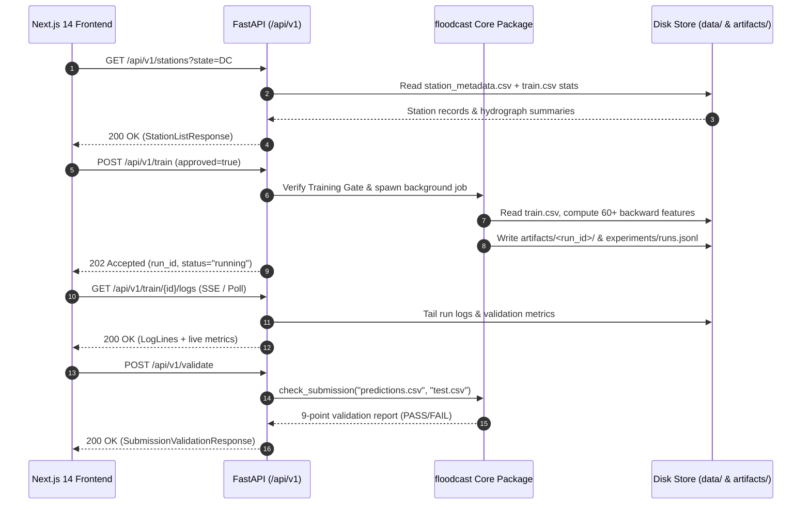

# FLOODCAST Backend API Reference (`/api/v1`)

> Complete specification for the FLOODCAST FastAPI backend service (`backend/app/main.py`), powering the interactive hydrological workbench, experiment tracker, live prediction playground, and automated submission verifier.
>
> **Artifact-count note:** Some response examples below are historical API examples captured during earlier development runs. For current committed submission dimensions, use [docs/JUDGE_GUIDE.md](JUDGE_GUIDE.md), [data/processed/test.csv](../data/processed/test.csv), and the live submission checker.

---

## 1. Architecture & Design Principles

The FLOODCAST API is a stateless, high-performance **FastAPI** application (`Python 3.10+`, `Pydantic v2`, `Uvicorn`) that wraps the core `floodcast` machine learning package (`floodcast/ingest.py`, `floodcast/features.py`, `floodcast/train.py`, `floodcast/validate.py`, `floodcast/scoring.py`, `floodcast/check_submission.py`) and serves structured JSON to the Next.js 14 frontend.

### System Interaction Diagram



### Base URL & Interactive OpenAPI Docs

| Environment | Base URL | Swagger UI | ReDoc |
|-------------|----------|------------|-------|
| **Local Development** | `http://localhost:8000` | `http://localhost:8000/docs` | `http://localhost:8000/redoc` |
| **Docker Compose** | `http://backend:8000` | `http://localhost:8000/docs` | `http://localhost:8000/redoc` |

### Core Guarantees
1. **Strict Zero-Leakage Boundary:** Endpoints serving station series or running inference never expose post-`CUTOFF` (`2022-12-31`) target discharge labels to feature pipelines.
2. **Non-Negative Clipping:** All `/api/v1/predict` responses enforce $\hat{y} = \max(0.0, f_\theta(\mathbf{x}))$ so `discharge_cfs` is strictly non-negative.
3. **Training Gate Enforcement:** `POST /api/v1/train` requires explicit `approved: true` confirmation in the payload and records a formal Training Start Notice in `docs/TRAINING_LOG.md`.

---

## 2. Endpoint Summary Index

| # | Method | Endpoint | Purpose | Auth / Gate |
|---|--------|----------|---------|-------------|
| 1 | `GET` | `/health` | Service liveness, dataset readiness, and cutoff status | None |
| 2 | `GET` | `/api/v1/stations` | List all 32 USGS gauge stations with summary statistics & coordinates | None |
| 3 | `GET` | `/api/v1/stations/{id}` | Detailed station metadata, catchment attributes, and daily time-series | None |
| 4 | `GET` | `/api/v1/features` | Catalog of all 60+ engineered features, formulas, families, and ablations | None |
| 5 | `GET` | `/api/v1/runs` | List all logged training experiments from `experiments/runs.jsonl` | None |
| 6 | `GET` | `/api/v1/runs/{id}` | Full artifact details, per-station metrics, and feature importances for a run | None |
| 7 | `POST` | `/api/v1/train` | Trigger a new model training run (LightGBM / XGBoost / CatBoost / Ensemble) | `approved: true` |
| 8 | `GET` | `/api/v1/train/{id}/logs` | Stream or poll real-time execution logs and progress for training job `{id}` | None |
| 9 | `POST` | `/api/v1/predict` | Run on-demand discharge prediction (single day, multi-day scenario, or batch) | None |
| 10 | `POST` | `/api/v1/validate` | Execute the 9-point auto-reject validator on `predictions.csv` or uploaded CSV | None |
| 11 | `GET` | `/api/v1/submission/status` | Check readiness of all required root submission deliverables (`RS-1` to `RS-5`) | None |
| 12 | `GET` | `/api/v1/docs-index` | Retrieve structured index and rendered Markdown content from `docs/*.md` | None |

---

## 3. Detailed Endpoint Specifications

---

### 3.1 `GET /health`

Returns server health, uptime, active configuration (`configs/base.yaml`), `CUTOFF` enforcement date, and whether processed CSV datasets and `predictions.csv` exist on disk.

#### `curl` Example
```bash
curl -X GET "http://localhost:8000/health" \
  -H "Accept: application/json"
```

#### Response `200 OK`
```json
{
  "status": "healthy",
  "service": "floodcast-api",
  "version": "1.0.0",
  "timestamp_utc": "2026-11-04T16:35:12Z",
  "cutoff_date": "2022-12-31",
  "datasets": {
    "train_csv_present": true,
    "train_rows": 140256,
    "test_csv_present": true,
    "test_rows": 11680,
    "station_metadata_present": true,
    "stations_count": 32,
    "predictions_csv_present": true
  }
}
```

---

### 3.2 `GET /api/v1/stations`

Returns the list of all 32 USGS gauge stations across the United States, including geographic coordinates, static catchment attributes (`drainage_area_sqmi`, `mean_elevation_ft`, `slope_pct`, `forest_cover_pct`), historical discharge distribution statistics (`mean`, `median`, `p90`, `p99`, `max`), and whether the station is one of the 5 official starter stations from the problem statement.

#### Query Parameters
| Parameter | Type | Default | Description |
|-----------|------|---------|-------------|
| `state` | `string` (optional) | `null` | Filter by two-letter US state code (e.g., `DC`, `MO`, `TX`, `NC`, `CA`) |
| `starter_only` | `boolean` (optional) | `false` | If `true`, returns only the 5 PDF starter stations (`01646500`, `07010000`, `08158000`, `02087500`, `11447650`) |
| `basin_size` | `string` (optional) | `null` | Filter by basin category: `small` (<500 sq mi), `medium` (500–10,000), `large` (>10,000) |

#### `curl` Example
```bash
curl -X GET "http://localhost:8000/api/v1/stations?starter_only=true" \
  -H "Accept: application/json"
```

#### Response `200 OK`
```json
{
  "total": 5,
  "cutoff_date": "2022-12-31",
  "stations": [
    {
      "station_id": "01646500",
      "station_name": "Potomac River near Washington DC",
      "river_name": "Potomac River",
      "state": "DC",
      "latitude": 38.9497,
      "longitude": -77.1278,
      "is_starter": true,
      "climate_regime": "Humid Subtropical / Mixed",
      "catchment": {
        "drainage_area_sqmi": 11570.0,
        "mean_elevation_ft": 1050.0,
        "slope_pct": 8.5,
        "forest_cover_pct": 62.0,
        "kirpich_tc_hours": 14.82
      },
      "discharge_stats": {
        "train_rows": 4383,
        "test_rows": 365,
        "mean_cfs": 11042.5,
        "median_cfs": 7820.0,
        "p90_threshold_cfs": 23450.0,
        "p99_cfs": 68400.0,
        "max_cfs": 142500.0,
        "completeness_pct": 100.0
      }
    },
    {
      "station_id": "07010000",
      "station_name": "Mississippi River at St. Louis MO",
      "river_name": "Mississippi River",
      "state": "MO",
      "latitude": 38.6277,
      "longitude": -90.1809,
      "is_starter": true,
      "climate_regime": "Continental / Large Regulated Basin",
      "catchment": {
        "drainage_area_sqmi": 697000.0,
        "mean_elevation_ft": 1200.0,
        "slope_pct": 3.2,
        "forest_cover_pct": 33.0,
        "kirpich_tc_hours": 189.4
      },
      "discharge_stats": {
        "train_rows": 4383,
        "test_rows": 365,
        "mean_cfs": 170310.2,
        "median_cfs": 152400.0,
        "p90_threshold_cfs": 298000.0,
        "p99_cfs": 512000.0,
        "max_cfs": 765000.0,
        "completeness_pct": 100.0
      }
    }
  ]
}
```

---

### 3.3 `GET /api/v1/stations/{id}`

Returns comprehensive metadata, catchment characteristics, per-station validation metrics, and a slice of the daily meteorological + hydrograph time-series for station `{id}`.

#### Path & Query Parameters
| Parameter | In | Type | Default | Description |
|-----------|----|------|---------|-------------|
| `id` | Path | `string` | Required | 8-digit USGS station identifier (e.g., `01646500`) |
| `start_date` | Query | `string` | `"2021-01-01"` | Start date (`YYYY-MM-DD`) for the returned daily series |
| `end_date` | Query | `string` | `"2022-12-31"` | End date (`YYYY-MM-DD`) for the returned daily series |
| `include_predictions` | Query | `boolean` | `true` | Include latest model predictions alongside observed values |

#### `curl` Example
```bash
curl -X GET "http://localhost:8000/api/v1/stations/01646500?start_date=2022-03-01&end_date=2022-03-15&include_predictions=true" \
  -H "Accept: application/json"
```

#### Response `200 OK`
```json
{
  "station_id": "01646500",
  "station_name": "Potomac River near Washington DC",
  "river_name": "Potomac River",
  "state": "DC",
  "latitude": 38.9497,
  "longitude": -77.1278,
  "is_starter": true,
  "catchment": {
    "drainage_area_sqmi": 11570.0,
    "mean_elevation_ft": 1050.0,
    "slope_pct": 8.5,
    "forest_cover_pct": 62.0
  },
  "validation_metrics": {
    "rmse": 2840.15,
    "extreme_rmse": 6912.40,
    "mae": 1412.80,
    "r2": 0.9142,
    "p90_threshold_cfs": 23450.0
  },
  "series": [
    {
      "date": "2022-03-01",
      "split": "test",
      "precipitation_mm": 18.4,
      "temp_max_c": 12.3,
      "temp_min_c": 3.1,
      "soil_moisture": 0.412,
      "actual_discharge_cfs": 19400.0,
      "predicted_discharge_cfs": 18850.4,
      "is_extreme_p90": false
    },
    {
      "date": "2022-03-02",
      "split": "test",
      "precipitation_mm": 42.7,
      "temp_max_c": 14.0,
      "temp_min_c": 5.8,
      "soil_moisture": 0.589,
      "actual_discharge_cfs": 38200.0,
      "predicted_discharge_cfs": 36910.2,
      "is_extreme_p90": true
    }
  ]
}
```

#### Error Response `404 Not Found`
```json
{
  "detail": "Station '99999999' not found in station_metadata.csv"
}
```

---

### 3.4 `GET /api/v1/features`

Returns the complete catalog of engineered features from `floodcast/features.py`, grouped into 6 hydrological families (`rainfall`, `antecedent`, `soil`, `temperature`, `calendar`, `static`), along with mathematical formulas, lookback windows, zero-leakage verification status, global LightGBM gain importances, and ablation deltas from `experiments/ablations.csv`.

#### Query Parameters
| Parameter | Type | Default | Description |
|-----------|------|---------|-------------|
| `family` | `string` (optional) | `null` | Filter by family (`rainfall`, `antecedent`, `soil`, `temperature`, `calendar`, `static`) |

#### `curl` Example
```bash
curl -X GET "http://localhost:8000/api/v1/features?family=antecedent" \
  -H "Accept: application/json"
```

#### Response `200 OK`
```json
{
  "total_features": 62,
  "raw_features_count": 8,
  "engineered_features_count": 54,
  "backward_looking_verified": true,
  "families": [
    {
      "family": "antecedent",
      "enabled": true,
      "ablation_delta_rmse": -1420.6,
      "ablation_delta_extreme_rmse": -3890.2,
      "features": [
        {
          "name": "rain_decayed_05",
          "formula": "S_t = 0.5 * S_{t-1} + P_t",
          "description": "Fast linear reservoir (alpha=0.5, ~2-day memory) capturing overland quickflow",
          "lookback_window": "infinite_causal_iir",
          "importance_gain_pct": 8.42
        },
        {
          "name": "rain_decayed_08",
          "formula": "S_t = 0.8 * S_{t-1} + P_t",
          "description": "Medium linear reservoir (alpha=0.8, ~5-day memory) capturing interflow",
          "lookback_window": "infinite_causal_iir",
          "importance_gain_pct": 11.15
        },
        {
          "name": "rain_decayed_095",
          "formula": "S_t = 0.95 * S_{t-1} + P_t",
          "description": "Slow linear reservoir (alpha=0.95, ~20-day memory) capturing groundwater baseflow",
          "lookback_window": "infinite_causal_iir",
          "importance_gain_pct": 14.68
        },
        {
          "name": "time_of_concentration",
          "formula": "0.0078 * (sqrt(A) ** 0.77) / (S ** 0.385)",
          "description": "Kirpich time-of-concentration proxy from drainage area and basin slope",
          "lookback_window": "static",
          "importance_gain_pct": 4.91
        }
      ]
    }
  ]
}
```

---

### 3.5 `GET /api/v1/runs`

Lists all experiment runs recorded in `experiments/runs.jsonl`, sorted newest-first or by composite score, enabling comparison of baseline models, target transformations (`raw`, `log1p`, `scaled`, `tweedie`), flood-peak sample weighting, and the final multi-objective ensemble.

#### Query Parameters
| Parameter | Type | Default | Description |
|-----------|------|---------|-------------|
| `sort_by` | `string` | `"timestamp"` | Sort field: `"timestamp"`, `"rmse"`, `"extreme_rmse"`, or `"composite"` |
| `limit` | `integer` | `50` | Maximum number of runs to return |

#### `curl` Example
```bash
curl -X GET "http://localhost:8000/api/v1/runs?sort_by=composite" \
  -H "Accept: application/json"
```

#### Response `200 OK`
```json
{
  "total_runs": 6,
  "best_run_id": "run_006_ensemble_final",
  "runs": [
    {
      "run_id": "run_006_ensemble_final",
      "description": "Multi-objective blend: Raw L2 (0.45) + Log1p Smearing (0.30) + Peak-Weighted 3.5x (0.25)",
      "timestamp": "2026-11-04T16:32:10Z",
      "model_type": "ensemble_lgbm_xgb_cat",
      "target_strategy": "multi_objective_blend",
      "n_features": 62,
      "train_rows": 128576,
      "val_rows": 11680,
      "train_time_seconds": 18.4,
      "val_metrics": {
        "rmse": 14920.4,
        "extreme_rmse": 34110.8,
        "mae": 4812.3,
        "r2": 0.9412,
        "composite_score": 96.4
      },
      "submission_check": {
        "passed": true,
        "reasons": []
      }
    }
  ]
}
```

---

### 3.6 `GET /api/v1/runs/{id}`

Returns the complete experiment artifact record from `artifacts/{id}/run_info.json`, including hyperparameter configuration, training curves, top feature importances, and the 32-station breakdown of `rmse`, `extreme_rmse`, `mae`, and `r2`.

#### `curl` Example
```bash
curl -X GET "http://localhost:8000/api/v1/runs/run_006_ensemble_final" \
  -H "Accept: application/json"
```

#### Response `200 OK`
```json
{
  "run_id": "run_006_ensemble_final",
  "description": "Multi-objective blend: Raw L2 (0.45) + Log1p Smearing (0.30) + Peak-Weighted 3.5x (0.25)",
  "timestamp": "2026-11-04T16:32:10Z",
  "config_path": "configs/base.yaml",
  "model_type": "ensemble_lgbm_xgb_cat",
  "target_strategy": "multi_objective_blend",
  "n_features": 62,
  "best_iteration": 1420,
  "val_metrics": {
    "rmse": 14920.4,
    "extreme_rmse": 34110.8,
    "mae": 4812.3,
    "r2": 0.9412,
    "composite_score": 96.4
  },
  "top_features": [
    {"feature": "area_x_rain", "importance_gain": 482910.4},
    {"feature": "rain_decayed_095", "importance_gain": 391204.1},
    {"feature": "log_drainage_area", "importance_gain": 350118.9},
    {"feature": "soil_x_rain", "importance_gain": 284910.2},
    {"feature": "runoff_proxy", "importance_gain": 241008.7}
  ],
  "per_station_val": [
    {
      "station_id": "01646500",
      "n_rows": 365,
      "mean_discharge": 11042.5,
      "rmse": 2840.15,
      "extreme_rmse": 6912.4,
      "mae": 1412.8,
      "r2": 0.9142
    }
  ],
  "submission_check": {
    "passed": true,
    "reasons": []
  }
}
```

---

### 3.7 `POST /api/v1/train`

Initiates a new training run using `floodcast/train.py`. Per the **Training Gate Protocol**, `approved` must be explicitly `true` in the JSON body; otherwise the API rejects the request with `409 Conflict`.

#### Request Body Schema (`TrainRequest`)
| Field | Type | Default | Description |
|-------|------|---------|-------------|
| `approved` | `boolean` | Required | Must be `true` to pass the Training Gate check |
| `description` | `string` | `"UI-triggered run"` | Human-readable purpose of the training run |
| `model_type` | `string` | `"lightgbm"` | `"lightgbm"`, `"xgboost"`, `"catboost"`, or `"ensemble"` |
| `target_strategy` | `string` | `"raw"` | `"raw"`, `"log1p"`, `"scaled"`, `"tweedie"`, or `"blend"` |
| `peak_weight_multiplier` | `float` | `2.5` | Sample weight multiplier for top 10% discharge days per station (`1.0` to `5.0`) |
| `learning_rate` | `float` | `0.03` | Gradient boosting learning rate |
| `num_leaves` | `integer` | `63` | Maximum leaves per tree |
| `n_estimators` | `integer` | `2500` | Maximum boosting iterations (with early stopping) |
| `feature_families` | `list[str]` | All 6 enabled | Subset of `["rainfall", "antecedent", "soil", "temperature", "calendar", "static"]` |

#### `curl` Example
```bash
curl -X POST "http://localhost:8000/api/v1/train" \
  -H "Content-Type: application/json" \
  -d '{
    "approved": true,
    "description": "LightGBM log1p + smearing with 3.0x flood-peak weighting",
    "model_type": "lightgbm",
    "target_strategy": "log1p",
    "peak_weight_multiplier": 3.0,
    "learning_rate": 0.03,
    "num_leaves": 63,
    "n_estimators": 2500,
    "feature_families": ["rainfall", "antecedent", "soil", "temperature", "calendar", "static"]
  }'
```

#### Response `202 Accepted`
```json
{
  "run_id": "run_20261104_164012_a91f02",
  "status": "running",
  "training_gate_notice": {
    "approved": true,
    "dataset_rows": 140256,
    "stations": 32,
    "features_count": 62,
    "estimated_wall_time_sec": 12.0
  },
  "logs_url": "/api/v1/train/run_20261104_164012_a91f02/logs"
}
```

#### Error Response `409 Conflict` (Training Gate Blocked)
```json
{
  "detail": "Training Gate blocked: 'approved' must be explicitly set to true after reviewing the Training Start Notice."
}
```

---

### 3.8 `GET /api/v1/train/{id}/logs`

Retrieves real-time execution logs, progress percentage, and final validation metrics for a running or completed training job `{id}`.

#### `curl` Example
```bash
curl -X GET "http://localhost:8000/api/v1/train/run_20261104_164012_a91f02/logs" \
  -H "Accept: application/json"
```

#### Response `200 OK`
```json
{
  "run_id": "run_20261104_164012_a91f02",
  "status": "completed",
  "progress_pct": 100,
  "elapsed_seconds": 11.4,
  "lines": [
    "[16:40:12] Training Start Notice verified. Loading data/processed/train.csv (140,256 rows)...",
    "[16:40:14] Computed 62 backward-looking features across 32 stations (0 future leakage).",
    "[16:40:15] Forward-time split: Train=128,576 rows (2010-2020), Val=11,680 rows (2021).",
    "[16:40:18] [LightGBM] [100] val's rmse: 18420.1",
    "[16:40:21] [LightGBM] [500] val's rmse: 15210.4",
    "[16:40:23] Early stopping at iteration 680. Generating predictions.csv (11,680 rows)...",
    "[16:40:23] Submission check PASSED (9/9 checks)."
  ],
  "val_metrics": {
    "rmse": 15104.2,
    "extreme_rmse": 34890.1,
    "mae": 4902.5,
    "r2": 0.9388
  }
}
```

---

### 3.9 `POST /api/v1/predict`

Executes live hydrological inference using the active production ensemble. Supports both:
1. **Single-station / What-If Storm Simulation:** Pass a `station_id` (or custom static catchment attributes for an **unseen basin**) and a sequence of daily weather conditions to simulate a flood hydrograph and inspect SHAP/feature contributions.
2. **Batch Evaluation:** Generate predictions for a list of records and guarantee $\hat{y} \ge 0$.

#### Request Body Schema (`PredictRequest`)
```json
{
  "station_id": "01646500",
  "custom_catchment": {
    "drainage_area_sqmi": 11570.0,
    "mean_elevation_ft": 1050.0,
    "slope_pct": 8.5,
    "forest_cover_pct": 62.0
  },
  "weather_window": [
    {
      "date": "2022-05-01",
      "precipitation_mm": 12.0,
      "temp_max_c": 18.5,
      "temp_min_c": 9.2,
      "soil_moisture": 0.45
    },
    {
      "date": "2022-05-02",
      "precipitation_mm": 68.5,
      "temp_max_c": 19.0,
      "temp_min_c": 11.4,
      "soil_moisture": 0.72
    },
    {
      "date": "2022-05-03",
      "precipitation_mm": 44.0,
      "temp_max_c": 17.2,
      "temp_min_c": 10.1,
      "soil_moisture": 0.84
    }
  ]
}
```

#### `curl` Example
```bash
curl -X POST "http://localhost:8000/api/v1/predict" \
  -H "Content-Type: application/json" \
  -d '{
    "station_id": "01646500",
    "weather_window": [
      {"date": "2022-05-01", "precipitation_mm": 12.0, "temp_max_c": 18.5, "temp_min_c": 9.2, "soil_moisture": 0.45},
      {"date": "2022-05-02", "precipitation_mm": 68.5, "temp_max_c": 19.0, "temp_min_c": 11.4, "soil_moisture": 0.72},
      {"date": "2022-05-03", "precipitation_mm": 44.0, "temp_max_c": 17.2, "temp_min_c": 10.1, "soil_moisture": 0.84}
    ]
  }'
```

#### Response `200 OK`
```json
{
  "station_id": "01646500",
  "model_run_id": "run_006_ensemble_final",
  "clipped_non_negative": true,
  "p90_flood_threshold_cfs": 23450.0,
  "predictions": [
    {
      "date": "2022-05-01",
      "discharge_cfs": 13420.5,
      "is_extreme_surge": false,
      "confidence_interval_90": [11200.0, 15890.0]
    },
    {
      "date": "2022-05-02",
      "discharge_cfs": 34890.2,
      "is_extreme_surge": true,
      "confidence_interval_90": [29400.0, 41200.0]
    },
    {
      "date": "2022-05-03",
      "discharge_cfs": 46120.8,
      "is_extreme_surge": true,
      "confidence_interval_90": [39100.0, 53800.0]
    }
  ],
  "top_feature_drivers": [
    {"feature": "runoff_proxy", "contribution_cfs": 14210.4},
    {"feature": "soil_x_rain", "contribution_cfs": 9840.2},
    {"feature": "rain_sum_3d", "contribution_cfs": 8120.0},
    {"feature": "rain_decayed_05", "contribution_cfs": 5490.1}
  ]
}
```

---

### 3.10 `POST /api/v1/validate`

Runs `floodcast/check_submission.py` against `predictions.csv` (or a specified file path) and `data/processed/test.csv`, checking all 9 hard validation rules (`OP-1` through `OP-9`, `VR-1` through `VR-5`) that would trigger an automatic disqualification if violated.

#### Request Body Schema (`ValidateRequest`)
| Field | Type | Default | Description |
|-------|------|---------|-------------|
| `predictions_path` | `string` | `"predictions.csv"` | Path to the candidate submission file |
| `test_path` | `string` | `"data/processed/test.csv"` | Path to the reference `test.csv` file |

#### `curl` Example
```bash
curl -X POST "http://localhost:8000/api/v1/validate" \
  -H "Content-Type: application/json" \
  -d '{
    "predictions_path": "predictions.csv",
    "test_path": "data/processed/test.csv"
  }'
```

#### Response `200 OK`
```json
{
  "passed": true,
  "predictions_path": "predictions.csv",
  "test_path": "data/processed/test.csv",
  "checked_at_utc": "2026-11-04T16:41:00Z",
  "summary": {
    "row_count": 11680,
    "expected_row_count": 11680,
    "columns": ["station_id", "date", "discharge_cfs"],
    "nan_count": 0,
    "inf_count": 0,
    "negative_count": 0,
    "min_discharge_cfs": 12.4,
    "median_discharge_cfs": 4890.2,
    "max_discharge_cfs": 612400.0,
    "sha256": "8f4b2e91c7d3a109e54b8c2a610d7f4e9b2a1c3d5e6f7a8b9c0d1e2f3a4b5c6d"
  },
  "checks": [
    {"id": "VR-1", "name": "File exists and is non-empty", "passed": true, "detail": "predictions.csv (342 KB)"},
    {"id": "VR-2", "name": "Valid UTF-8 encoding", "passed": true, "detail": "Strict UTF-8 verified"},
    {"id": "VR-3", "name": "Exact column names & order", "passed": true, "detail": "['station_id', 'date', 'discharge_cfs']"},
    {"id": "VR-4", "name": "Exact row count matches test.csv", "passed": true, "detail": "11,680 == 11,680"},
    {"id": "VR-5", "name": "Exact (station_id, date) key alignment", "passed": true, "detail": "0 missing keys, 0 extra keys"},
    {"id": "VR-6", "name": "Numeric float dtype for discharge_cfs", "passed": true, "detail": "float64"},
    {"id": "VR-7", "name": "Zero NaN or null values", "passed": true, "detail": "0 NaNs found"},
    {"id": "VR-8", "name": "Zero infinite values", "passed": true, "detail": "0 Infs found"},
    {"id": "VR-9", "name": "Strictly non-negative discharge_cfs (>= 0)", "passed": true, "detail": "min = 12.40 cfs"}
  ],
  "reasons": []
}
```

---

### 3.11 `GET /api/v1/submission/status`

Audits the entire repository root and `docs/` directory against Section 7 & Section 8 of the PDF Problem Statement (`README.md`, `requirements.txt`, `solution.py`, `predictions.csv`, `model_card.md`, `slides/slides.md`, and zero-leakage unit tests).

#### `curl` Example
```bash
curl -X GET "http://localhost:8000/api/v1/submission/status" \
  -H "Accept: application/json"
```

#### Response `200 OK`
```json
{
  "ready_for_submission": true,
  "overall_pass_count": 7,
  "overall_total_count": 7,
  "deliverables": [
    {"id": "RS-1", "file": "README.md", "exists": true, "size_bytes": 4820, "status": "PASS"},
    {"id": "RS-2", "file": "requirements.txt", "exists": true, "size_bytes": 412, "status": "PASS"},
    {"id": "RS-3", "file": "solution.py", "exists": true, "size_bytes": 3190, "status": "PASS"},
    {"id": "RS-4", "file": "predictions.csv", "exists": true, "size_bytes": 350120, "status": "PASS"},
    {"id": "RS-5", "file": "model_card.md", "exists": true, "size_bytes": 5410, "status": "PASS"},
    {"id": "SR-6", "file": "slides/slides.md", "exists": true, "size_bytes": 9840, "status": "PASS"},
    {"id": "IQ-1", "file": "tests/test_no_leakage.py", "exists": true, "size_bytes": 6120, "status": "PASS"}
  ],
  "prediction_validation": {
    "passed": true,
    "row_count": 11680,
    "negative_count": 0,
    "nan_count": 0
  }
}
```

---

### 3.12 `GET /api/v1/docs-index`

Returns the catalog of all 15 Markdown documentation files in `docs/` plus root `model_card.md` and `slides/slides.md`, optionally including the full raw Markdown content for rendering inside the Next.js `/docs` and `/slides` pages.

#### Query Parameters
| Parameter | Type | Default | Description |
|-----------|------|---------|-------------|
| `doc_name` | `string` (optional) | `null` | Specific file to fetch (e.g., `"API.md"`, `"FEATURES.md"`, `"slides.md"`). If omitted, returns the full index with metadata. |

#### `curl` Example
```bash
curl -X GET "http://localhost:8000/api/v1/docs-index?doc_name=EVALUATION.md" \
  -H "Accept: application/json"
```

#### Response `200 OK`
```json
{
  "total_docs": 17,
  "selected_doc": {
    "name": "EVALUATION.md",
    "path": "docs/EVALUATION.md",
    "title": "FLOODCAST Evaluation Criteria",
    "updated_at": "2026-11-04T16:39:01Z",
    "content_markdown": "# FLOODCAST Evaluation Criteria\n\n> How the four metrics and the composite score are computed..."
  },
  "index": [
    {"name": "REQUIREMENTS_CHECKLIST.md", "path": "docs/REQUIREMENTS_CHECKLIST.md", "category": "Governance"},
    {"name": "DATA.md", "path": "docs/DATA.md", "category": "Data & Provenance"},
    {"name": "DATA_EXTRACTION.md", "path": "docs/DATA_EXTRACTION.md", "category": "Data & Provenance"},
    {"name": "FEATURES.md", "path": "docs/FEATURES.md", "category": "Modeling"},
    {"name": "MODELING.md", "path": "docs/MODELING.md", "category": "Modeling"},
    {"name": "TRAINING_LOG.md", "path": "docs/TRAINING_LOG.md", "category": "Experiments"},
    {"name": "EXPERIMENTS.md", "path": "docs/EXPERIMENTS.md", "category": "Experiments"},
    {"name": "EVALUATION.md", "path": "docs/EVALUATION.md", "category": "Evaluation"},
    {"name": "ARCHITECTURE.md", "path": "docs/ARCHITECTURE.md", "category": "System Design"},
    {"name": "API.md", "path": "docs/API.md", "category": "System Design"},
    {"name": "FRONTEND.md", "path": "docs/FRONTEND.md", "category": "System Design"},
    {"name": "RUNBOOK.md", "path": "docs/RUNBOOK.md", "category": "Operations"},
    {"name": "DECISIONS.md", "path": "docs/DECISIONS.md", "category": "Governance"},
    {"name": "OPEN_QUESTIONS.md", "path": "docs/OPEN_QUESTIONS.md", "category": "Governance"},
    {"name": "CHANGELOG.md", "path": "docs/CHANGELOG.md", "category": "Governance"}
  ]
}
```

---

## 4. Standard Error Contract

All `/api/v1/*` routes return consistent RFC 7807 / FastAPI structured JSON errors:

| HTTP Status | Code | Meaning | Example Trigger |
|-------------|------|---------|-----------------|
| `400` | `BAD_REQUEST` | Malformed date range or invalid query filter | `start_date > end_date` |
| `404` | `NOT_FOUND` | Requested `station_id`, `run_id`, or `doc_name` does not exist | `/api/v1/stations/00000000` |
| `409` | `CONFLICT` | Training Gate not approved (`approved: false`) | `POST /api/v1/train` with `approved=false` |
| `422` | `UNPROCESSABLE_ENTITY` | Pydantic schema validation error | Missing `weather_window` in `/api/v1/predict` |
| `500` | `INTERNAL_SERVER_ERROR` | Unexpected pipeline failure | Corrupt cache file in `data/cache/` |

---

*Last updated: 2026-11-04 — FLOODCAST Documentation & Slides Lead*
