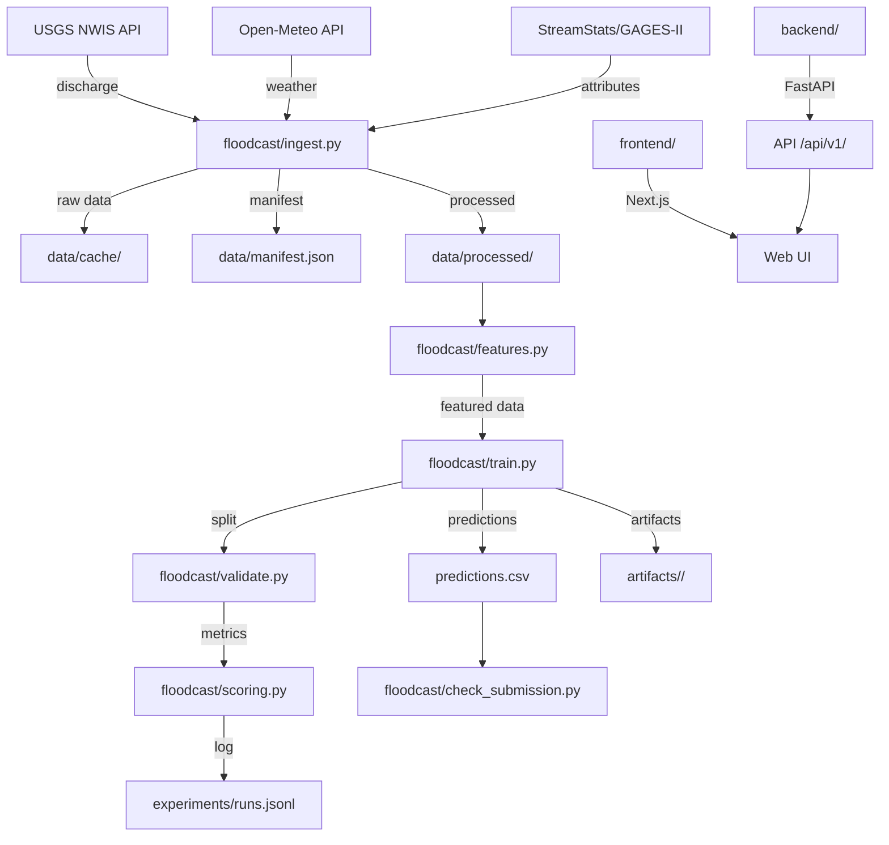

# FLOODCAST Architecture

## System Diagram



## Pipeline Stages

| Stage | Module | Input | Output |
|-------|--------|-------|--------|
| 1. Ingest | `floodcast/ingest.py` | APIs + config | `data/processed/*.csv` |
| 2. Features | `floodcast/features.py` | Processed CSVs | Feature-enriched DataFrames |
| 3. Validate | `floodcast/validate.py` | Featured data | Train/val splits |
| 4. Train | `floodcast/train.py` | Splits + config | Trained model |
| 5. Score | `floodcast/scoring.py` | Predictions + labels | Metrics |
| 6. Predict | `floodcast/train.py` | Model + test data | `predictions.csv` |
| 7. Check | `floodcast/check_submission.py` | predictions + test | PASS/FAIL |

## Repository Layout

```
hackoween/
├── README.md                    # Project overview
├── requirements.txt             # Dependencies
├── solution.py                  # One-command entry point
├── predictions.csv              # Model output
├── model_card.md                # Model documentation
├── Makefile                     # Build targets
├── docker-compose.yml           # Website deployment
│
├── floodcast/                   # Core Python package
│   ├── __init__.py
│   ├── __main__.py              # CLI: python -m floodcast <cmd>
│   ├── ingest.py                # Data ingestion
│   ├── features.py              # Feature engineering
│   ├── train.py                 # Training pipeline
│   ├── validate.py              # Validation schemes
│   ├── scoring.py               # Metrics computation
│   └── check_submission.py      # Submission validator
│
├── configs/
│   └── base.yaml                # All config (stations, features, model params)
│
├── data/
│   ├── raw/starter/             # Organizer files (if provided)
│   ├── cache/                   # Raw API response cache
│   ├── processed/               # Cleaned, joined CSVs
│   └── manifest.json            # Extraction provenance log
│
├── experiments/
│   ├── runs.jsonl               # All experiment records
│   └── ablations.csv            # Feature ablation results
│
├── artifacts/<run_id>/          # Per-run: model, config, metrics
│
├── tests/
│   └── test_no_leakage.py       # Leakage + scorer tests
│
├── docs/                        # All documentation
│
├── slides/                      # Presentation
│
├── backend/                     # FastAPI backend
│   └── app/
│       ├── main.py
│       ├── routers/
│       ├── services/
│       ├── schemas/
│       └── core/
│
└── frontend/                    # Next.js frontend
```

---

*Last updated: 2026-11-04 Phase A*
