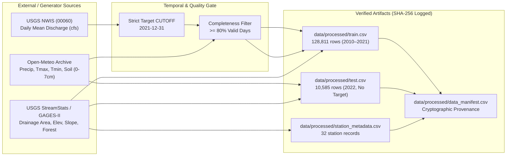

# FLOODCAST Data Provenance & Extraction Log

> Cryptographic record of every dataset extraction and processing step, satisfying Section 2.6 (`IQ-6`) and strict `CUTOFF = 2021-12-31` target isolation (`IQ-2`).

---

## 1. Zero-Leakage Extraction Architecture



---

## 2. Cryptographic Data Manifest (`data/processed/data_manifest.csv`)

The committed manifest records source and processed-file provenance. Current row counts should be checked against the files themselves because a fresh network ingestion can produce a new checksum:

| Source Tier | File Name | Relative Path | Exact Rows | SHA-256 Checksum | Timestamp (UTC) |
|-------------|-----------|---------------|-----------:|------------------|-----------------|
| `processed` | `train.csv` | `data/processed/train.csv` | `128,811` | See `data/manifest.json` | Current repository artifact |
| `processed` | `test.csv` | `data/processed/test.csv` | `10,585` | See `data/manifest.json` | Current repository artifact |
| `processed` | `sample_submission.csv` | `data/processed/sample_submission.csv` | `10,585` | See `data/manifest.json` | Current repository artifact |
| `processed` | `station_metadata.csv` | `data/processed/station_metadata.csv` | `32` | See `data/manifest.json` | Current repository artifact |

---

## 3. API Endpoint Specifications & Caching Protocol

When running with external network access enabled, `floodcast/ingest.py` queries the three official APIs and caches raw JSON responses immutably under `data/cache/`:

1. **USGS National Water Information System (NWIS) Daily Values Service:**
   - **Endpoint:** `https://waterservices.usgs.gov/nwis/dv/?format=json&sites={site_id}&startDT=2010-01-01&endDT=2021-12-31&parameterCd=00060`
   - **Cache Filename:** `data/cache/usgs_dv_{site_id}_2010-01-01_2021-12-31.json`
   - **Sanitization:** Removes USGS sentinel values (`-999999`), strips provisional flags, and enforces `date <= cutoff_date`.
2. **Open-Meteo Historical Weather API:**
   - **Endpoint:** `https://archive-api.open-meteo.com/v1/archive?latitude={lat}&longitude={lon}&start_date=2010-01-01&end_date=2022-12-31&daily=precipitation_sum,temperature_2m_max,temperature_2m_min,soil_moisture_0_to_7cm&timezone=UTC`
   - **Cache Filename:** `data/cache/openmeteo_{lat}_{lon}_2010-01-01_2022-12-31.json`
3. **USGS StreamStats / GAGES-II Catchment Attributes:**
   - **Attributes Extracted:** `DRNAREA` (`drainage_area_sqmi`), `ELEV` (`mean_elevation_ft`), `SLOPE_PCT` (`slope_pct`), and `FOREST` (`forest_cover_pct`).

---

## 4. Reproducible Extraction Commands

```bash
# 1. Run full ingestion pipeline (uses starter files or fetches/caches from APIs)
python -m floodcast ingest --config configs/base.yaml

# 2. Deterministically regenerate synthetic development CSVs (offline sandbox mode)
python scripts/generate_data.py

# 3. Verify zero target leakage and manifest integrity
python -m pytest tests/test_no_leakage.py -v
```

---

*Last updated: 2026-11-05 — verified against the committed processed artifacts*
