# FLOODCAST Frontend Architecture & Design System

> Complete engineering documentation for the **Next.js 14 App Router** web application (`frontend/`), providing a production-grade hydrological observatory, interactive flood-surge simulator, experiment leaderboard, and submission verification suite.

---

## 1. Architectural Overview

The FLOODCAST web application is built with **Next.js 14 (App Router, TypeScript, Tailwind CSS, Recharts / Lucide Icons)** and communicates with the FastAPI backend (`/api/v1/*`) via typed asynchronous data fetchers with automatic local-JSON fallback so every screen renders deterministically even in offline evaluation environments.

### Next.js App Router & Component Hierarchy

```mermaid
flowchart TD
    Root["app/layout.tsx (Hydrological Dark Theme + TopNav + StatusBanner)"]

    Root --> P1["1. / (Mission Control Dashboard)"]
    Root --> P2["2. /stations (32-Station Catalog & US Map)"]
    Root --> P3["3. /stations/[id] (Station Hydrograph Deep-Dive)"]
    Root --> P4["4. /data (Data Provenance & Manifest Explorer)"]
    Root --> P5["5. /features (60+ Feature Studio & Ablations)"]
    Root --> P6["6. /experiments (Model Leaderboard & 40/30/20/10 Scorer)"]
    Root --> P7["7. /train (Training Gate Console & Live Log Stream)"]
    Root --> P8["8. /evaluate (Flood-Peak Diagnostics & LOSO CV)"]
    Root --> P9["9. /predict (Interactive Storm Simulator Playground)"]
    Root --> P10["10. /submission (9-Point Validator & Deliverable Shield)"]
    Root --> P11["11. /docs (In-App Documentation & Model Card Viewer)"]
    Root --> P12["12. /slides (Interactive 5-Slide Pitch Deck)"]

    P3 --> C1["<HydrographChart /> (Observed vs Predicted + P90 Threshold)"]
    P3 --> C2["<CatchmentCard /> (Area, Elevation, Slope, Forest, Kirpich Tc)"]
    P6 --> C3["<CompositeScoreSimulator /> (40% RMSE / 30% Ext / 20% MAE / 10% R²)"]
    P7 --> C4["<TrainingGateModal /> (Enforces Start Notice & User Approval)"]
    P9 --> C5["<StormHyetographSliders /> (Real-time What-If Runoff Response)"]
    P10 --> C6["<SubmissionCheckMatrix /> (9 Auto-Reject Checks + SHA-256)"]
```



---

## 2. The 12 Next.js App Router Pages & PDF Problem Statement Mapping

Every page in the application is purpose-built to satisfy and visually verify specific requirements from `FLOODCAST_Participant_PS_Updated.pdf`:

| # | Route | Page Title | Key Interactive Components | PDF Problem Statement Requirements Satisfied |
|---|-------|------------|----------------------------|---------------------------------------------|
| **1** | `/` | **Mission Control & Executive Overview** | KPI metric cards (`RMSE`, `Extreme RMSE`, `MAE`, `R²`, `Composite`), 32-station geospatial overview, `CUTOFF = 2022-12-31` zero-leakage badge, quick pipeline status | **PSA-1, PSA-3, EC-1–EC-7:** Summarizes daily `discharge_cfs` prediction performance and the 40/30/20/10 composite evaluation formula. |
| **2** | `/stations` | **USGS Station Explorer** | Searchable/filterable grid & interactive US map of all 32 stations (5 starter stations pinned with badges + 27 diverse expansion stations), climate zone tags, basin size filters | **DS1-1, DS1-2, DS1-3, IO-4:** Showcases the 5 mandatory starter stations (`01646500`, `07010000`, `08158000`, `02087500`, `11447650`) plus 27 additional stations across snowmelt, arid, coastal, and regulated regimes. |
| **3** | `/stations/[id]` | **Station Hydrograph & Basin Deep-Dive** | Dual-axis inverted rainfall hyetograph (top, `mm`) + discharge hydrograph (bottom, `cfs`), P90 extreme flood threshold line, static catchment radar, per-station error table | **DS2-1, DS3-1, EC-2:** Visualizes how precipitation, temperature, soil moisture, and catchment attributes (`DRNAREA`, `ELEV`, `SLOPE_PCT`, `FOREST`) drive station-specific flood peaks. |
| **4** | `/data` | **Data Provenance & Extraction Manifest** | 3-source join schema diagram (`station_id` and `(lat, lon, date)`), live `data/manifest.json` table with SHA-256 checksums, completeness audit (>80% threshold), `CUTOFF` audit | **DS1–DS3, DJ-1, DJ-2, IQ-2, IQ-6:** Proves zero target leakage after `2022-12-31` and full cryptographic provenance of every raw & processed dataset. |
| **5** | `/features` | **Hydrological Feature Studio** | Interactive filter across 6 feature families (`62` total features), LaTeX formula cards, causal backward-looking window inspector, LightGBM feature gain bar chart, ablation table | **RA-4, IQ-3:** Documents how linear reservoir decay ($\alpha \in \{0.5, 0.8, 0.95\}$), Kirpich $T_c$, SCS runoff proxy, and degree-days improve RMSE without future leakage. |
| **6** | `/experiments` | **Experiments & Composite Leaderboard** | Sortable run comparison table (`experiments/runs.jsonl`), target strategy comparison (`raw`, `log1p`, `scaled`, `tweedie`, `blend`), interactive 0–100 Composite Score normalizer | **EC-1–EC-7:** Demonstrates the progression from naive baselines to the flood-peak-weighted multi-objective ensemble under the exact PDF normalization formula. |
| **7** | `/train` | **Training Console & Gate Control** | Hyperparameter & feature-family toggles, mandatory **Training Gate Start Notice** review card, explicit approval switch (`approved: true`), live log terminal (`/api/v1/train/{id}/logs`) | **IQ-7 (Section 0A):** Enforces the strict Training Gate protocol so no compute run starts without displaying dataset size, features, hyperparams, and user approval. |
| **8** | `/evaluate` | **Flood-Peak & Diagnostic Error Analysis** | Actual vs. Predicted scatter (linear & log-log), top 10% flood-event hydrograph zoom-ins, residual violin/box plots by climate zone, Leave-One-Station-Out (LOSO) generalization table | **PSA-4, EC-2:** Evaluates model accuracy on the top 10% extreme discharge days per station (30% weight) and unseen river basins (geographic generalization). |
| **9** | `/predict` | **Interactive Storm & Surge Simulator** | Multi-day rainfall/temperature/soil-moisture sliders, custom unseen-basin attribute editor (`drainage_area_sqmi`, `slope_pct`, etc.), real-time hydrograph response + feature attributions | **PSA-1, PSA-2, PSA-4:** Allows judges to stress-test the model on synthetic extreme storms or completely unseen catchment configurations with guaranteed $\hat{y} \ge 0$. |
| **10** | `/submission` | **Submission Validator & Disqualification Shield** | 9-point automated check table (`VR-1` to `VR-9`), root deliverable readiness matrix (`README.md`, `requirements.txt`, `solution.py`, `predictions.csv`, `model_card.md`), CSV preview | **OP-1–OP-9, VR-1–VR-5, DQ-1–DQ-6, RS-1–RS-5:** Guarantees zero auto-rejections (exact 11,680 rows, 3 columns, UTF-8, 0 NaNs, 0 negative values). |
| **11** | `/docs` | **Documentation & Model Card Portal** | Sidebar document navigator for all 15 `docs/*.md` files + `model_card.md`, rendered Markdown tables, Mermaid diagrams, and `DECISIONS.md` / `OPEN_QUESTIONS.md` callouts | **SR-3, SR-5, DQ-5:** Surfaces the complete model card, pre-trained declaration (`None`), known limitations, and architectural decisions directly in the UI. |
| **12** | `/slides` | **Executive 5-Slide Presentation Deck** | Full-screen slide deck viewer (`slides/slides.md`) with keyboard arrow navigation, speaker notes toggle, progress bar, and embedded hydrograph & scoring visuals | **SR-6:** Delivers the 5-slide hackathon presentation (Problem → Data → Model → Results → Limitations) ready for the Hour-22 live pitch. |

---

## 3. Design System: "Hydrological Dark Mode"

The visual language is inspired by **NOAA National Water Center (NWC) operational river forecasting consoles**—combining high-contrast dark slate surfaces with semantic hydrological color encoding so extreme flood peaks, normal baseflow, and precipitation hyetographs are immediately distinguishable at a glance.

### 3.1 Color Tokens

| Token Name | Hex / Tailwind | CSS Variable | Semantic Role in FLOODCAST |
|------------|----------------|--------------|----------------------------|
| **Abyssal Background** | `#070B14` (`slate-950`) | `--bg-canvas` | Primary application backdrop |
| **Observatory Surface** | `#0F172A` (`slate-900`) | `--bg-surface` | Cards, hydrograph panels, and metric containers |
| **Elevated Panel** | `#1E293B` (`slate-800`) | `--bg-elevated` | Hover states, table headers, modal dialogs |
| **Subtle Border** | `#334155` (`slate-700/60`) | `--border-subtle` | Hairline grid dividers and chart axes |
| **Observed Flow Cyan** | `#06B6D4` (`cyan-500`) | `--color-observed` | Actual USGS `discharge_cfs` hydrograph curve |
| **Predicted Flow Indigo** | `#818CF8` (`indigo-400`) | `--color-predicted` | FLOODCAST ensemble predicted `discharge_cfs` curve |
| **Precipitation Sky** | `#38BDF8` (`sky-400/50`) | `--color-precip` | Inverted top-axis daily rainfall bars (`precipitation_mm`) |
| **Extreme Surge Amber** | `#F59E0B` (`amber-500`) | `--color-p90` | Per-station 90th percentile (`top 10%`) flood threshold line |
| **Critical Flood Rose** | `#F43F5E` (`rose-500`) | `--color-extreme` | Peak error highlights & disqualification warning badges |
| **Verified Emerald** | `#10B981` (`emerald-500`) | `--color-verified` | `PASS` badges, `CUTOFF` compliance, and zero-leakage checks |

### 3.2 Typography Scale

| Element | Font Family | Weight & Size | Features | Usage |
|---------|-------------|---------------|----------|-------|
| **Display / Hero KPI** | `Plus Jakarta Sans` / `Inter` | `700 Bold`, `2.25rem` (`36px`) | `tracking-tight` | Composite score, headline metrics |
| **Page Title (`H1`)** | `Plus Jakarta Sans` / `Inter` | `600 SemiBold`, `1.5rem` (`24px`) | `tracking-tight` | Top-level view headers |
| **Section Header (`H2`)** | `Inter` | `600 SemiBold`, `1.125rem` (`18px`) | Standard | Card titles, hydrograph headers |
| **Body Copy** | `Inter` | `400 Regular`, `0.875rem` (`14px`) | `leading-relaxed` | Documentation, hydrological rationale |
| **Numeric / Telemetry** | `JetBrains Mono` | `500 Medium`, `0.8125rem` (`13px`) | `font-variant-numeric: tabular-nums` | `discharge_cfs`, USGS `station_id`, SHA-256 hashes, RMSE tables |

### 3.3 Accessibility & Hydrological Chart Ergonomics
- **WCAG 2.1 AA Contrast:** All primary text (`#F8FAFC`) and muted telemetry labels (`#94A3B8`) exceed `4.5:1` contrast against `#0F172A`.
- **Colorblind-Safe Hydrographs:** Observed discharge uses a **solid `2px` cyan line** (`#06B6D4`), predicted discharge uses a **high-contrast dashed indigo/white line** (`#818CF8`, `strokeDasharray="6 3"`), and the P90 flood threshold uses a **dotted amber reference line** (`#F59E0B`), ensuring full legibility under deuteranopia, protanopia, and grayscale printing.
- **Keyboard & Screen-Reader Support:** All 12 navigation routes, slide deck controls (`ArrowLeft` / `ArrowRight` / `Space`), and Training Gate confirmation dialogs support full keyboard navigation and `aria-live="polite"` status announcements.

---

## 4. Directory Layout (`frontend/`)

```text
frontend/
├── package.json
├── next.config.mjs
├── tailwind.config.ts
├── tsconfig.json
└── src/
    ├── app/
    │   ├── layout.tsx                 # Global shell, sidebar/top navigation, status bar
    │   ├── page.tsx                   # 1.  /            — Mission Control Overview
    │   ├── stations/
    │   │   ├── page.tsx               # 2.  /stations    — 32 USGS Station Explorer
    │   │   └── [id]/
    │   │       └── page.tsx           # 3.  /stations/[id] — Station Hydrograph Deep-Dive
    │   ├── data/
    │   │   └── page.tsx               # 4.  /data        — Data Provenance & Manifest
    │   ├── features/
    │   │   └── page.tsx               # 5.  /features    — 60+ Feature Engineering Studio
    │   ├── experiments/
    │   │   └── page.tsx               # 6.  /experiments — Leaderboard & Composite Scorer
    │   ├── train/
    │   │   └── page.tsx               # 7.  /train       — Training Gate & Live Console
    │   ├── evaluate/
    │   │   └── page.tsx               # 8.  /evaluate    — Flood-Peak & LOSO Diagnostics
    │   ├── predict/
    │   │   └── page.tsx               # 9.  /predict     — Interactive Storm Simulator
    │   ├── submission/
    │   │   └── page.tsx               # 10. /submission  — 9-Point Submission Validator
    │   ├── docs/
    │   │   └── page.tsx               # 11. /docs        — Embedded Documentation Portal
    │   └── slides/
    │       └── page.tsx               # 12. /slides      — Executive 5-Slide Presentation
    ├── components/
    │   ├── Navbar.tsx                 # 12-route navigation bar + live API health indicator
    │   ├── HydrographChart.tsx        # Dual-axis rainfall + observed/predicted discharge chart
    │   ├── CompositeScoreCard.tsx     # 40/30/20/10 interactive normalization calculator
    │   └── SubmissionBadge.tsx        # Real-time PASS/FAIL status indicator
    └── lib/
        ├── api.ts                     # Typed FastAPI client with offline fallback data
        └── fallbackData.ts            # Deterministic snapshot of stations, runs, and metrics
```

---

*Last updated: 2026-11-04 — FLOODCAST Documentation & Slides Lead*
